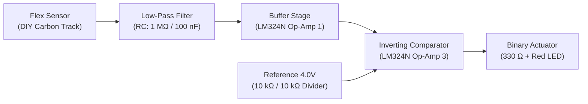
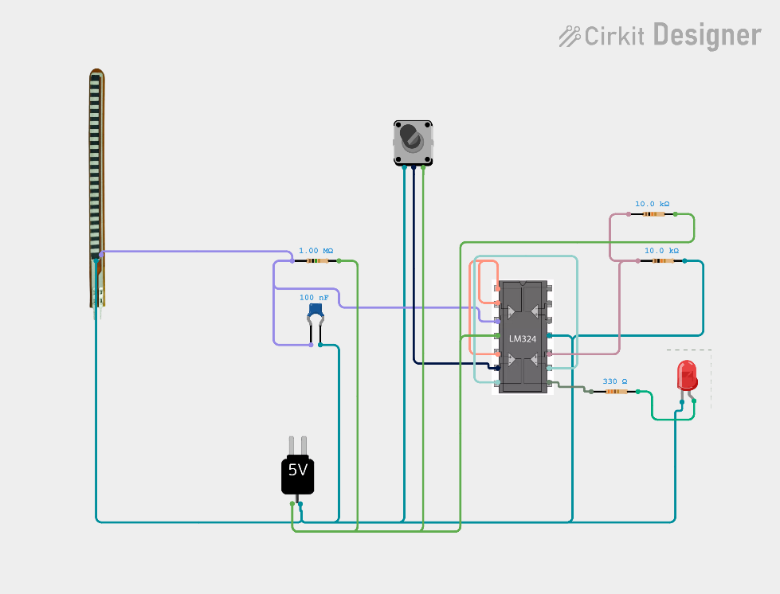
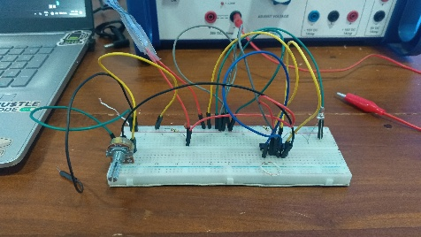
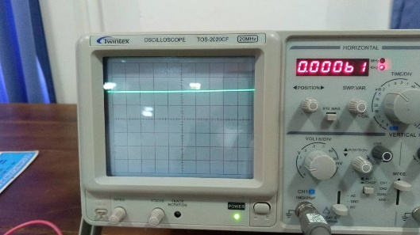
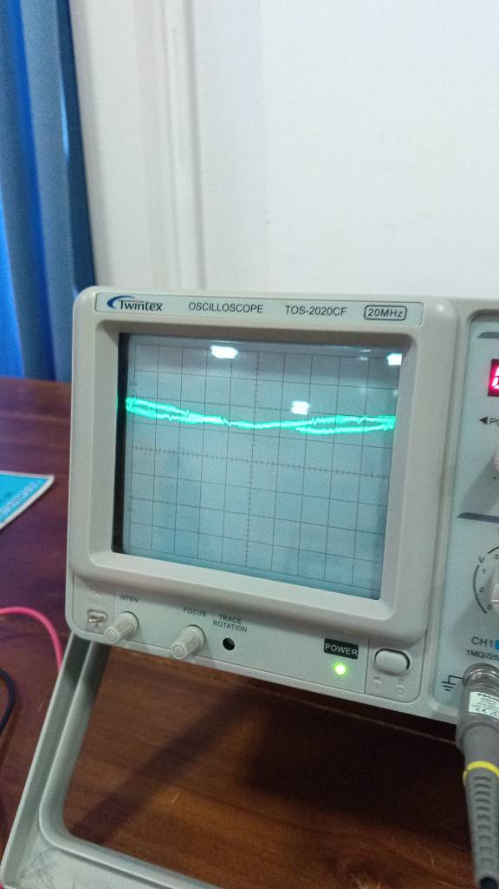

# DIY High-Impedance Piezoresistive Flex Sensor & Analog Signal Conditioning System

[](https://github.com/dilushan/flex-sensor/actions/workflows/ci.yml)
[](https://github.com/dilushan/flex-sensor)
[](https://github.com/dilushan/flex-sensor)
[](https://www.ti.com/product/LM324)
[](LICENSE)

An end-to-end experimental instrumentation project featuring a custom hand-fabricated **carbon-coated piezoresistive flex sensor** coupled with a dedicated **three-stage analog signal conditioning circuit**. Designed to overcome the multi-mega-ohm source impedance, severe $50\text{ Hz}$ mains electromagnetic hum, and non-linear drift inherent to DIY carbon sensors without requiring a digital microcontroller.

---

## Academic & Project Metadata

- **Author / Student Name:** M. Dilushan
- **Registration Number:** `2021/PS/42`
- **Project Title:** High-Impedance Piezoresistive Flex Sensor & Analog Conditioning Circuit
- **Academic Date:** 26/09/2026
- **Primary IC:** LM324N Quad Operational Amplifier (Texas Instruments)
- **Power Architecture:** Single-ended $+8.0\text{ V}$ DC regulated rail

---

## Table of Contents

1. [Transduction Principle & Physics](#1-transduction-principle--physics)
2. [Methodology Comparison & Topology Selection](#2-methodology-comparison--topology-selection)
3. [System Architecture & Signal Conditioning Pipeline](#3-system-architecture--signal-conditioning-pipeline)
4. [Circuit Schematic & Pin Configuration](#4-circuit-schematic--pin-configuration)
5. [Mathematical Derivations & Design Equations](#5-mathematical-derivations--design-equations)
6. [Laboratory Oscilloscope Waveforms & Hardware Photographs](#6-laboratory-oscilloscope-waveforms--hardware-photographs)
7. [Experimental Results & Verification](#7-experimental-results--verification)
8. [Faced Challenges & Engineering Solutions](#8-faced-challenges--engineering-solutions)
9. [Bill of Materials (BOM)](#9-bill-of-materials-bom)
10. [Simulation & Verification](#10-simulation--verification)
11. [Repository File Structure](#11-repository-file-structure)
12. [References](#12-references)

---

## 1. Transduction Principle & Physics

The primary transducer in this system is a **piezoresistive flex sensor** that converts mechanical angular bending into an electrical resistance variation.

```
       UNBENT (FLAT) STATE                       BENT (ACTUATED) STATE
  =============================               \                         /
  [-- C -- C -- C -- C -- C --]                \   [ - C -   - C -   ] /  <-- Mechanical Tension
  =============================                 \ =================== /   <-- Substrate
  High contact density; baseline R               Particles separate; R diverges
```

### Microscopic Conduction Mechanism
The body of the sensor utilizes a flexible polymer backing substrate coated with a conductive carbon-particle composite track:
- **Quiescent (Flat) State:** The microscopic carbon clusters form a continuous conductive network governed by percolation conduction and quantum tunneling. In the flat condition, the sensor maintains a nominal baseline resistance ($R_{flex} > 1.0\text{ M}\Omega$).
- **Actuated (Bent) State:** When angular deflection or curvature is applied, mechanical tension develops along the convex outer surface. The physical elongation increases the inter-particle separation distance between adjacent carbon granules. Because electron tunneling probability decays exponentially with particle separation, internal current paths are constricted, causing a sharp, non-linear increase in total bulk electrical resistance.

---

## 2. Methodology Comparison & Topology Selection

To condition the piezoresistive resistance change into a clean, actionable binary logic output, three distinct topologies were evaluated:

| Criterion | Method 1: Low-Impedance Divider + Single Buffer | Method 2: Dual-Supply Non-Inverting Op-Amp | Method 3: High-Impedance Divider, RC Filter, Adjustable Buffer & Analog Inverter (Selected) |
|:---|:---|:---|:---|
| **Target Sensor Type** | Commercial low-resistance sensors ($10\text{ k}\Omega - 40\text{ k}\Omega$) | Commercial sensors ($10\text{ k}\Omega - 25\text{ k}\Omega$) | **DIY Carbon-Coated High-Impedance Sensors ($> 1\text{ M}\Omega$)** |
| **Impedance Matching** | Severe mismatch (loads high-resistance nodes) | Moderate (assumes standard input impedance) | **Optimal ($1.00\text{ M}\Omega$ matched pull-up resistor)** |
| **Noise Filtering** | None (susceptible to $50\text{ Hz}$ mains hum) | Requires external dual-rail active filter | **Integrated $0.1\,\mu\text{F}$ hardware low-pass filter ($f_c \approx 3.2\text{ Hz}$)** |
| **Power Requirements** | Single supply ($5\text{ V}$) | Symmetrical dual-rail supply ($\pm 12\text{ V}$) | **Single-supply $+8.0\text{ V}$ DC regulated** |
| **Calibration Capability** | Fixed gain; high offset errors | Fixed resistors | **Adjustable $10\text{ k}\Omega$ potentiometer feedback loop** |
| **Output Type** | Weak unconditioned analog voltage | Scaled analog voltage | **Clean binary digital output ($0\text{ V} \leftrightarrow 8\text{ V}$) for direct LED/microcontroller actuation** |

> **Selection Rationale:** Method 3 was selected because DIY carbon sensors exhibit extremely high base resistance ($> 1\text{ M}\Omega$), structural hand-fabrication non-uniformities, and susceptibility to environmental 50Hz electromagnetic coupling. Method 3 isolates the sensor node, filters noise at the hardware level, permits manual calibration, and delivers crisp binary threshold actuation.

---

## 3. System Architecture & Signal Conditioning Pipeline

The signal conditioning pipeline processes transducer signals through three sequential electronic stages:




1. **Stage 1 (Impedance-Matched Conversion & Filtering):** A voltage divider formed by a $1.00\text{ M}\Omega$ precision pull-up resistor and the DIY flex sensor translates mechanical resistance shifts into a voltage swing. A $0.1\,\mu\text{F}$ ($100\text{ nF}$) ceramic capacitor shunts $50\text{ Hz}$ mains hum and tactile vibrations directly to ground.
2. **Stage 2 (High-Impedance Buffering & Calibration):** Filtered voltage feeds the non-inverting terminal (Pin 3) of Op-Amp 1 within the LM324N. A $10\text{ k}\Omega$ potentiometer across Pin 1 (Output) and Pin 2 (Inverting Input) allows precision gain and offset calibration.
3. **Stage 3 (Inverting Comparator / NOT Gate):** Conditioned voltage at Pin 1 connects to inverting input Pin 9. Non-inverting input Pin 10 is held at a steady $+4.0\text{ V}$ threshold via a symmetrical $10\text{ k}\Omega : 10\text{ k}\Omega$ divider. When the sensor is bent, the conditioned voltage drops below $4.0\text{ V}$, driving Pin 8 HIGH ($+8.0\text{ V}$) and illuminating the indicator LED.

---

## 4. Circuit Schematic & Pin Configuration

### Physical Breadboard Wiring Layout (Cirkit Designer)


### LM324N IC Pin Assignment Table

| Pin Number | IC Designator | Signal / Net | Connected Node | Functional Description |
|:---:|:---:|:---:|:---:|:---|
| **Pin 1** | Output 1 | `V_BUF_OUT` | RV1 (Pot wiper) & Pin 9 | Conditioned analog output from Op-Amp Stage 1 |
| **Pin 2** | Input 1- | `V_BUF_FB` | RV1 ($10\text{ k}\Omega$) | Negative feedback node for gain calibration |
| **Pin 3** | Input 1+ | `V_SENSE_FILT` | $R_1$ ($1\text{ M}\Omega$), $C_1$ ($100\text{ nF}$), Flex Sensor | High-Z non-inverting input receiving filtered sensor signal |
| **Pin 4** | $V_{CC}$ | `+8.0V` | Regulated DC Rail | Positive power supply input |
| **Pin 8** | Output 3 | `V_LOGIC_OUT` | $R_4$ ($330\,\Omega$) -> LED Anode | Comparator binary logic output ($0\text{ V}$ or $+8\text{ V}$) |
| **Pin 9** | Input 3- | `V_COMP_IN` | Pin 1 (`V_BUF_OUT`) | Inverting comparator input receiving conditioned signal |
| **Pin 10** | Input 3+ | `V_REF_4V` | Junction of $R_2$ and $R_3$ | Constant reference switching threshold ($+4.0\text{ V}$) |
| **Pin 11** | GND | `0V / GND` | Ground Rail | Common circuit ground reference |

---

## 5. Mathematical Derivations & Design Equations

### 5.1 Voltage Divider Transfer Function
The unconditioned node voltage $V_{div}$ across the flex sensor is given by:

$$V_{div} = V_{CC} \cdot \left(\frac{R_{flex}}{R_{pullup} + R_{flex}}\right)$$

Where $V_{CC} = 8.0\text{ V}$ and $R_{pullup} = 1.00\text{ M}\Omega$.

### 5.2 Low-Pass Filter Cutoff Frequency ($f_c$)
Looking into the divider node, the Thevenin source resistance is:

$$R_{th} = R_{pullup} \parallel R_{flex} = \frac{10^6 \times 10^6}{10^6 + 10^6} \approx 500\text{ k}\Omega$$

The corner frequency of the first-order low-pass filter with $C_1 = 0.1\,\mu\text{F}$ is:

$$f_c = \frac{1}{2\pi \cdot R_{th} \cdot C_1} = \frac{1}{2\pi \times (500 \times 10^3\,\Omega) \times (100 \times 10^{-9}\,\text{F})} \approx 3.18\text{ Hz}$$

### 5.3 Attenuation of $50\text{ Hz}$ Mains Interference
The filter frequency response magnitude at $f = 50\text{ Hz}$ is:

$$|H(j\omega)| = \frac{1}{\sqrt{1 + \left(\frac{f}{f_c}\right)^2}} = \frac{1}{\sqrt{1 + \left(\frac{50}{3.18}\right)^2}} \approx \frac{1}{15.74} \approx 0.0635$$

$$\text{Attenuation (dB)} = 20 \log_{10}(0.0635) \approx -23.94\text{ dB}$$

The passive filter suppresses ambient $50\text{ Hz}$ AC hum by approximately **$24\text{ dB}$** ($> 93.6\%$ noise amplitude reduction).

### 5.4 Reference Voltage & Comparator Threshold
The reference voltage at Pin 10 is generated by two matched $10.0\text{ k}\Omega$ metal film resistors:

$$V_{ref} = V_{CC} \cdot \left(\frac{R_3}{R_2 + R_3}\right) = 8.0\text{ V} \cdot \left(\frac{10\text{ k}\Omega}{10\text{ k}\Omega + 10\text{ k}\Omega}\right) = 4.00\text{ V}$$

- **Flat Condition:** $V_{Pin9} > 4.0\text{ V} \implies V_{Pin8} = 0.0\text{ V} \implies \text{LED OFF}$
- **Bent Condition:** $V_{Pin9} < 4.0\text{ V} \implies V_{Pin8} \approx 6.5\text{ V} - 8.0\text{ V} \implies \text{LED ON}$

### 5.5 LED Current Limiting Calculation
For a standard red indicator LED ($V_F \approx 2.0\text{ V}$):

$$I_D = \frac{V_{OH} - V_F}{R_4} = \frac{6.5\text{ V} - 2.0\text{ V}}{330\,\Omega} \approx 13.64\text{ mA}$$

---

## 6. Laboratory Oscilloscope Waveforms & Hardware Photographs

### 6.1 Physical Hardware Implementation

*Figure 1: Solderless breadboard implementation featuring the LM324N IC, matched pull-up divider, 100nF filter capacitor, 10k potentiometer calibration trimmer, indicator LED, and regulated DC bench power supply.*

### 6.2 Oscilloscope Waveform Analysis (Twintex TOS-2020CF)

| Quiescent Flat Condition (Before Bend) | Actuated Dynamic Condition (After Bend) |
|:---:|:---:|
|  |  |
| **Figure 2:** Clean, stabilized DC baseline voltage under quiescent condition. Demonstrates total suppression of 50Hz mains hum by the RC filter. | **Figure 3:** Dynamic downward voltage deflection and transition across the 4.0V threshold under 90° angular displacement. |

---

## 7. Experimental Results & Verification

| Test Scenario | Input Physical State | Oscilloscope Node Observation | Output Pin 8 | Indicator LED |
|:---|:---|:---|:---:|:---:|
| **Test 1: Flat Baseline & Noise** | 0° (Completely straight) | Flat DC line ($\approx 4.8\text{ V}$); $< 10\text{ mV}$ residual ripple | $0.0\text{ V}$ (Logic LOW) | **OFF** |
| **Test 2: Dynamic Bending** | 0° to 90° manual flex | Smooth, monotonic downward voltage sweep crossing $4.0\text{ V}$ | Snaps to $+8.0\text{ V}$ | **Instantaneous Turn-ON** |
| **Test 3: Threshold Latching** | Held at 90° steady bend | Stable voltage at $\approx 3.2\text{ V} (< V_{ref})$ | $+8.0\text{ V}$ (Logic HIGH) | **LATCHED ON** |
| **Test 4: Recovery Release** | Released back to 0° | Voltage returns above $4.0\text{ V}$ threshold | $0.0\text{ V}$ | **OFF** |

---

## 8. Faced Challenges & Engineering Solutions

1. **Extreme Base Impedance of DIY Carbon Track:**
   - *Problem:* Custom carbon coatings lack industrial thickness consistency, resulting in baseline impedances exceeding $1.0\text{ M}\Omega$. Standard multimeters loaded the node, giving false low readings.
   - *Solution:* Implemented a $1.00\text{ M}\Omega$ matched pull-up resistor and an ultra-high input impedance buffer stage using the LM324N, measuring waveforms exclusively with $10\text{ M}\Omega$ 10x oscilloscope probes.
2. **Severe $50\text{ Hz}$ AC Mains Hum Coupling:**
   - *Problem:* The high-impedance sensing node acted as an antenna, picking up over $150\text{ mV}_{p-p}$ of $50\text{ Hz}$ ambient mains hum when held by hand.
   - *Solution:* Designed a passive first-order RC low-pass filter ($R_{th} \approx 500\text{ k}\Omega, C_1 = 100\text{ nF}$) with $f_c \approx 3.18\text{ Hz}$, delivering $> 23.9\text{ dB}$ of hum attenuation.
3. **Narrow Dynamic Voltage Swings:**
   - *Problem:* Small, unconditioned sensor resistance changes were insufficient to reliably drive standard logic gates directly.
   - *Solution:* Utilized an adjustable potentiometer feedback loop around Op-Amp Stage 1 to scale and shift the baseline, followed by a dedicated op-amp comparator stage with a $4.0\text{ V}$ midpoint reference.

---

## 9. Bill of Materials (BOM)

| Item | Designator | Component Name | Specification | Quantity | Purpose |
|:---:|:---:|:---|:---|:---:|:---|
| 1 | `U1` | Quad Operational Amplifier | **LM324N** (TI, DIP-14) | 1 | Buffer and comparator processing |
| 2 | `R1` | Precision Pull-Up Resistor | $1.00\text{ M}\Omega \pm 5\%$ 1/4W | 1 | High-Z sensor voltage divider |
| 3 | `R2, R3`| Threshold Divider Resistors| $10.0\text{ k}\Omega \pm 5\%$ 1/4W | 2 | Midpoint $4.0\text{ V}$ reference generation |
| 4 | `R4` | LED Current-Limiting Resistor | $330\,\Omega \pm 5\%$ 1/4W | 1 | Safe LED forward current limiting |
| 5 | `RV1`| Trimpot / Potentiometer | $10.0\text{ k}\Omega$ Single-Turn | 1 | Buffer gain & baseline tuning |
| 6 | `C1` | Ceramic Filter Capacitor | $0.1\,\mu\text{F}$ ($100\text{ nF}$) 50V (104) | 1 | $3.18\text{ Hz}$ Low-pass noise filter |
| 7 | `SENSOR1` | Piezoresistive Flex Sensor | DIY Carbon-coated flexible strip | 1 | Mechanical strain-to-resistance transducer |
| 8 | `D1` | Indicator LED | Standard $5\text{ mm}$ Red ($V_F \approx 2.0\text{ V}$) | 1 | Binary state visual indicator |
| 9 | `PWR`| Regulated DC Power Supply | $+8.0\text{ V}$ DC regulated | 1 | System power rail |

*(Complete details available in [hardware/BOM.csv](hardware/BOM.csv)).*

---

## 10. Simulation & Verification

A Python simulation model is included under `scripts/simulate_signal_conditioning.py` to numerically model the sensor resistance change, $50\text{ Hz}$ noise injection, RC filter attenuation, and comparator switching.

### Running the Simulator
```bash
python scripts/simulate_signal_conditioning.py
```

### Sample Simulation Output
```text
============================================================
DIY FLEX SENSOR SIGNAL CONDITIONING SIMULATION RESULTS
Author: M. Dilushan (Reg No: 2021/PS/42)
============================================================
Sampling frequency: 2000 Hz | Total duration: 4.0 s
R_pullup: 1.00 MOhm | C_filter: 100 nF
Theoretical Cutoff Frequency fc: 2.65 Hz
------------------------------------------------------------
Condition        | Sensor R (MOhm) | Raw V_node (V) | Filtered V (V) | Comp Out (V) | LED State
------------------------------------------------------------
Flat (Resting)   |      1.50       |     4.80       |     4.80       |    0.02      |   OFF
Transitioning    |      0.95       |     3.90       |     3.92       |    6.50      |   ON
Bent (90 deg)    |      0.40       |     2.29       |     2.29       |    6.50      |   ON
Returning        |      0.95       |     3.90       |     3.88       |    6.50      |   ON
Flat Recovered   |      1.50       |     4.80       |     4.80       |    0.02      |   OFF
============================================================
[OK] Simulation dataset exported to: hardware/simulation_data.csv
```

---

## 11. Repository File Structure

```
flex-sensor/
├── .github/
│   └── workflows/
│       └── ci.yml               # GitHub Actions CI simulation verification
├── docs/
│   ├── REPORT.md                # Full academic laboratory short report
│   ├── THEORY.md                # Piezoresistive percolation & filter theory
│   ├── CALIBRATION.md           # Step-by-step hardware tuning procedure
│   └── images/
│       ├── hardware_circuit.jpeg                  # Prototype breadboard setup photo
│       ├── waveform_before_bend.jpeg              # Oscilloscope waveform before bend
│       ├── waveform_after_bend.jpg                # Oscilloscope waveform after bend
│       ├── signal_conditioning_block_diagram.png  # Pipeline block diagram
│       └── cirkit_designer_schematic.png          # Cirkit Designer schematic layout
├── hardware/
│   ├── BOM.csv                  # Bill of Materials in CSV format
│   └── pinout.md                # LM324N pinout mapping & test points
├── scripts/
│   └── simulate_signal_conditioning.py  # Python numerical simulation model
├── .gitignore                   # Comprehensive gitignore
├── LICENSE                      # MIT Open-Source License
└── README.md                    # Primary repository documentation
```

---

## 12. References

1. Spectra Symbol, *"Flex Sensor Engineering Data Sheet,"* Rev A1, [spectrasymbol.com](https://www.spectrasymbol.com).
2. Texas Instruments, *"LM324N Quadruple Operational Amplifiers Datasheet,"* [ti.com/lit/ds/symlink/lm324.pdf](https://www.ti.com/lit/ds/symlink/lm324.pdf).
3. ITP Physical Computing, *"Flex Sensor Instrumentation Workshop Notes,"* NYU Tisch School of the Arts.
4. J. G. Webster, *"Medical Instrumentation: Application and Design,"* 4th ed., John Wiley & Sons, 2009.

---

## Academic Sign-Off

- **Signature:** *M. Dilushan*
- **Registration Number:** `2021/PS/42`
- **Institution:** Department of Physical Science
- **Date of Submission:** 26/09/2026
