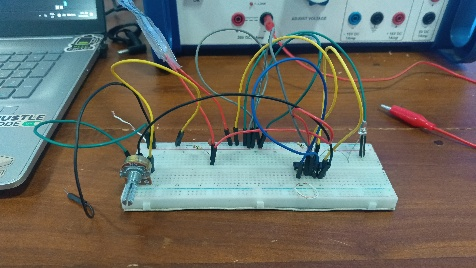
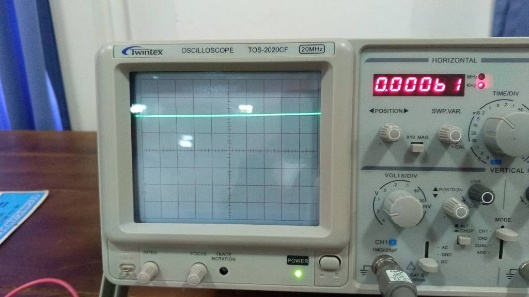
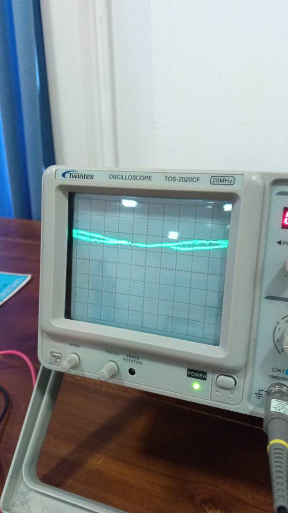
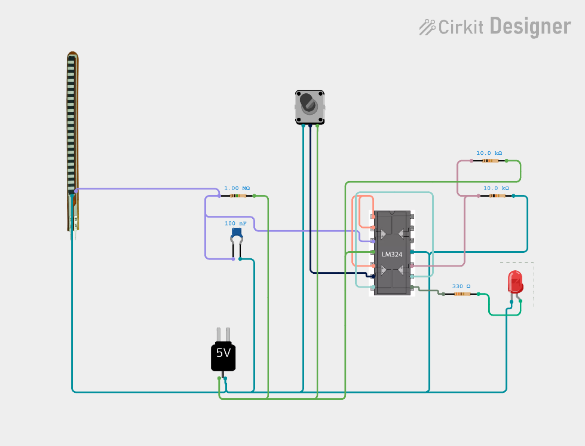

# Laboratory Short Report: DIY Piezoresistive Flex Sensor & Signal Conditioning System

| Attribute | Project Details |
|:---|:---|
| **Student Registration Number** | `2021/PS/42` |
| **Student Name** | M. Dilushan |
| **Project Title** | High-Impedance Piezoresistive Flex Sensor Design & Analog Signal Conditioning |
| **Academic Date** | 26/09/2026 |
| **Author Signature** | M. Dilushan |

---

## 1. Transduction Principle

The transducer designed and evaluated in this project is a **piezoresistive flex sensor** that converts mechanical angular bending into an electrical resistance variation.

The sensor body utilizes a thin, flexible polymer backing substrate coated with a conductive carbon-particle composite track. 
- In the **flat (quiescent) state**, the microscopic carbon particles establish a baseline contact density and percolation network, defining its flat nominal resistance.
- When **mechanical stress or angular displacement** is applied (bending), mechanical tension is induced along the convex outer surface. This structural elongation increases the intermolecular distances between adjacent carbon clusters, reducing conductive percolation pathways and throttling internal electron drift. Consequently, bending induces a significant non-linear increase in electrical resistance.

---

## 2. Referred Methods

To condition the piezoresistive resistance change into a measurable and actionable electronic signal, three distinct topology options were examined:

### Method 1: Low-Impedance Voltage Divider with Single-Ended Buffer
- **Topology:** Direct resistance-to-voltage conversion utilizing a low-impedance passive resistor divider network (e.g., $10\text{ k}\Omega - 47\text{ k}\Omega$) followed by a standard single-ended operational amplifier buffer.
- **Drawbacks:** Ineffective for DIY carbon tracks. DIY sensors exhibit base resistances in the mega-ohm range ($> 1\text{ M}\Omega$). Low-impedance dividers excessively load the sensor node, dampening the dynamic voltage swing into sub-millivolt ranges and rendering subsequent amplification highly prone to offset errors.

### Method 2: Dual-Supply Non-Inverting Amplifier for Commercial Sensors
- **Topology:** Symmetrical dual-supply ($\pm 12\text{ V}$) operational amplifier non-inverting amplifier configured for commercial flex sensors (which feature standard baseline resistances in the $10\text{ k}\Omega - 25\text{ k}\Omega$ range).
- **Drawbacks:** Requires a bulky, bipolar dual-rail power supply and commercial factory-calibrated sensors. Inapplicable for single-supply portable platforms and uncalibrated custom carbon tracks.

### Method 3: High-Impedance Matched Divider, Hardware RC Low-Pass Filter, Adjustable Buffer, and Inverting Comparator Stage
- **Topology:** High-input impedance voltage divider ($1\text{ M}\Omega$ pull-up matching sensor source impedance), hardware-level first-order ceramic low-pass filter ($100\text{ nF}$), single-supply operational amplifier buffer stage with potentiometer-calibrated gain, and an independent analog comparator stage configured as an inverter (NOT gate).
- **Advantages:** Perfectly addresses source impedance mismatch, rejects ambient 50Hz AC mains noise, provides user-tunable threshold calibration, and delivers crisp binary logic output for actuator drive.

---

## 3. Selected Method & Justification

**Method 3 was chosen** for hardware fabrication and experimental validation. 

Custom hand-fabricated carbon-based flex sensors typically exhibit an extraordinarily high base impedance (nominal $> 1\text{ M}\Omega$) and suffer from significant structural instability, making standard commercial conditioning schemes unviable. Method 3 resolves these core challenges by:
1. Matching the source impedance with a $1.00\text{ M}\Omega$ precision pull-up resistor to optimize the voltage swing across the node.
2. Integrating a hardware RC low-pass filter with a cutoff frequency around $3.2\text{ Hz}$, shunting ambient 50Hz electromagnetic mains hum and mechanical tremor directly to ground.
3. Leveraging the JFET/BJT high input impedance of an LM324N operational amplifier buffer stage to prevent circuit loading.
4. Implementing a secondary comparator stage configured as an analog inverter with an adjustable reference threshold ($4.0\text{ V}$), guaranteeing crisp binary threshold switching without requiring a digital microcontroller.

---

## 4. Working Principle & Circuit Architecture

The overall system architecture processes the transducer signals across three successive conditioning stages:

```
+-------------+      +-----------------+      +----------------+      +--------------------+      +-------------+
|  DIY Flex   | ---> | Low-Pass Filter | ---> | High-Impedance | ---> | Inverting Analog   | ---> | LED Binary  |
|   Sensor    |      | (RC: 1M / 100n) |      | Buffer / Gain  |      | Comparator (4V Ref)|      |  Indicator  |
+-------------+      +-----------------+      +----------------+      +--------------------+      +-------------+
```

### Stage 1: Impedance-Matched Resistance-to-Voltage Conversion
A voltage divider is formed by a fixed $1.00\text{ M}\Omega$ pull-up resistor ($R_1$) tied to $+8.0\text{ V}$ and the custom carbon flex sensor tied to ground. The analog voltage at the sensing node ($V_{div}$) is expressed as:
$$V_{div} = V_{CC} \cdot \frac{R_{flex}}{R_1 + R_{flex}}$$
A $0.1\,\mu\text{F}$ ($100\text{ nF}$) ceramic capacitor ($C_1$) placed in parallel with the flex sensor forms a passive low-pass filter with an effective cutoff frequency:
$$f_c = \frac{1}{2\pi \cdot (R_1 \parallel R_{flex}) \cdot C_1} \approx 3.18\text{ Hz}$$
This shunts environmental AC hum (50Hz mains) and tactile handling noise directly to ground.

### Stage 2: Buffer Amplification & Calibration Stage
The noise-filtered node voltage feeds directly into the non-inverting terminal (Pin 3) of Op-Amp Stage 1 within the LM324N IC. A $10\text{ k}\Omega$ potentiometer ($RV_1$) connected between the inverting input (Pin 2) and output (Pin 1) provides adjustable negative feedback, enabling manual calibration of the buffer gain and baseline offset. 
- When the sensor flexes, its internal resistance increases, altering the voltage distribution across the divider and driving the conditioned output at Pin 1 downwards.

### Stage 3: Analog Inverting Comparator Stage (NOT Gate)
The conditioned analog voltage at Pin 1 is routed to the inverting input (Pin 9) of Op-Amp Stage 3. The non-inverting terminal (Pin 10) is maintained at a precise $+4.0\text{ V}$ DC reference voltage established by a symmetrical 1:1 voltage divider ($R_2 = 10\text{ k}\Omega, R_3 = 10\text{ k}\Omega$) across the $+8.0\text{ V}$ rail:
$$V_{ref} = 8.0\text{ V} \cdot \frac{10\text{ k}\Omega}{10\text{ k}\Omega + 10\text{ k}\Omega} = 4.0\text{ V}$$
- **Flat State (Unbent):** The conditioned voltage at Pin 9 exceeds the $4.0\text{ V}$ reference ($V_{in} > V_{ref}$). Consequently, the comparator clamps Pin 8 to ground ($0.0\text{ V}$, Logic LOW), keeping the LED completely OFF.
- **Bent State (Actuated):** The conditioned voltage at Pin 9 drops below the $4.0\text{ V}$ threshold ($V_{in} < V_{ref}$). The op-amp output snaps to the positive rail ($\approx +8.0\text{ V}$, Logic HIGH), driving current through current-limiting resistor $R_4$ ($330\,\Omega$) and illuminating the LED.

---

## 5. Transducer Technical Specifications

| Parameter | Specification | Notes / Operating Conditions |
|:---|:---|:---|
| **Input Mechanical Range** | 0° to 90° angular deflection | From straight resting position to right-angle bend |
| **Baseline Flat Resistance** | $> 1.0\text{ M}\Omega$ nominal | High-impedance custom carbon track |
| **Supply Voltage ($V_{CC}$)** | $+8.0\text{ V}$ DC regulated | Single-supply rail operation |
| **Conditioned Output Range** | $0.0\text{ V}$ (LOW) to $+8.0\text{ V}$ (HIGH) | Binary digital output |
| **Low-Pass Filter Cutoff ($f_c$)** | $\approx 3.18\text{ Hz}$ | $R = 500\text{ k}\Omega$ equivalent, $C = 100\text{ nF}$ |
| **Noise Attenuation** | $> -20\text{ dB}$ at $50\text{ Hz}$ | Rejection of local AC mains electromagnetic interference |
| **Indicator Forward Current** | $\approx 13.6\text{ mA}$ | Through $330\,\Omega$ resistor, $V_F \approx 2.0\text{ V}$ |

---

## 6. Circuit Schematic & Hardware Photographs

### 6.1 Hardware Prototype Implementation

*Figure 1: Complete hardware implementation on a solderless breadboard with LM324N, high-impedance voltage divider, calibration potentiometer, filter capacitor, and regulated DC bench power supply.*

### 6.2 Oscilloscope Waveform Analysis
| Flat State (Before Bend) | Actuated State (After Bend) |
|:---:|:---:|
|  |  |
| *Figure 2: Oscilloscope trace showing a clean, stabilized DC baseline voltage at quiescent condition after RC filtering.* | *Figure 3: Oscilloscope trace capturing the downward dynamic voltage transition and switching response under angular deflection.* |

### 6.3 Signal Conditioning Architecture & Breadboard Diagram
| Signal Flow Block Diagram | Breadboard Wiring Layout (Cirkit Designer) |
|:---:|:---:|
|  |  |
| *Figure 4: Complete end-to-end signal conditioning processing pipeline.* | *Figure 5: Physical component wiring diagram generated using Cirkit Designer.* |

---

## 7. Experimental Results

Three structured tests were conducted on the hardware testbench:

1. **Test 1: Flat Condition & Noise Suppression Verification**
   - *Observation:* Prior to inserting the $0.1\,\mu\text{F}$ filter capacitor, the raw sensor node exhibited pronounced $50\text{ Hz}$ sinusoidal ripple ($\approx 150\text{ mV}_{p-p}$) coupled from surrounding ambient AC power cables.
   - *Outcome:* Following insertion of the $0.1\,\mu\text{F}$ capacitor, the noise ripple was suppressed below the oscilloscope noise floor, yielding a steady, flat DC trace.

2. **Test 2: Dynamic Signal Conditioning & Angular Displacement**
   - *Observation:* With the sensor held straight, the output at Pin 1 measured high ($> 4.5\text{ V}$). Manual bending from 0° to 90° produced a smooth, consistent downward voltage swing into Pin 9 without high-frequency microphonic chatter.

3. **Test 3: Threshold Switching & Actuator Actuation**
   - *Observation:* With the $10\text{ k}\Omega$ feedback potentiometer calibrated, the LED remained extinguished when the sensor was at rest. Upon reaching the target bend angle, Pin 8 transitioned cleanly from $0\text{ V}$ to $+8\text{ V}$, switching the LED on instantaneously.

---

## 8. Engineering Challenges & Solutions

| Challenge Encountered | Underlying Physical Cause | Engineering Solution Implemented |
|:---|:---|:---|
| **Extreme Baseline Impedance** | DIY graphite/carbon composite tracks lack industrial uniformity, yielding mega-ohm baseline resistance. Standard multimeters heavily loaded the circuit. | Selected a matched $1.00\text{ M}\Omega$ pull-up resistor and high input-impedance op-amp buffer stage, verifying voltages via high-impedance oscilloscope probe ($10\text{ M}\Omega$ input). |
| **50Hz AC Mains Interference** | High-impedance nodes act as antennas, picking up strong electromagnetic fields from laboratory mains wiring. | Integrated a $0.1\,\mu\text{F}$ ceramic capacitor directly at the sensor node to form a low-pass filter with $f_c \approx 3.2\text{ Hz}$. |
| **Narrow Voltage Swings** | Hand-crafted carbon tracks exhibited non-linear, small dynamic voltage variations that failed to trigger standard TTL/CMOS logic gates. | Implemented an LM324 op-amp buffer with adjustable potentiometer feedback gain followed by an analog comparator threshold stage. |

---

## 9. References

1. Spectra Symbol, *"Flex Sensor Data Sheet,"* Rev A1, spectrasymbol.com.
2. Texas Instruments, *"LM324N Quad Operational Amplifiers Datasheet,"* ti.com/lit/ds/symlink/lm324.pdf.
3. ITP Physical Computing, *"Flex Sensor Instrumentation Workshop Notes,"* NYU Tisch School of the Arts.
